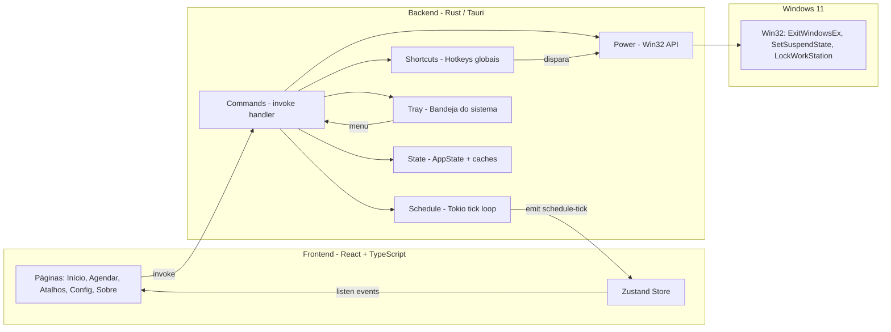

# ⚡ Wise Auto Shutdown

> **Gerencie o ciclo de energia do seu Windows 11 com estilo, agendamento e atalhos globais.**

O **Wise Auto Shutdown** é um aplicativo de desktop nativo, leve e bonito, feito para quem
quer desligar, reiniciar, suspender, hibernar, bloquear ou encerrar sessão — imediatamente,
agendado ou via atalho de teclado — sem caixas de diálogo do Windows feias ou comandos no terminal.

<div align="center">


</div>

---

## 📑 Sumário

- [O que é](#-o-que-é)
- [Por que existe](#-por-que-existe)
- [Funcionalidades](#-funcionalidades)
- [Como funciona](#-como-funciona)
- [Arquitetura e Engenharia](#️-arquitetura-e-engenharia)
- [Stack Tecnológica](#-stack-tecnológica)
- [Pré-requisitos](#-pré-requisitos)
- [Instalação](#-instalação)
- [Como usar](#-como-usar)
- [Desinstalação](#-desinstalação)
- [Estrutura do projeto](#-estrutura-do-projeto)
- [Scripts disponíveis](#-scripts-disponíveis)
- [Solução de problemas](#-solução-de-problemas)

---

## 💡 O que é

O **Wise Auto Shutdown** é um utilitário de energia para Windows 11 construído com
[Tauri 2](https://v2.tauri.app/) (Rust + WebView2). Ele entrega uma interface moderna,
fluida e com suporte a **Mica** (o efeito de vidro nativo do Windows 11), colocando o
controle total do ciclo de vida do seu PC em um único lugar:

| Ação | Ícone | Descrição resumida |
|------|-------|--------------------|
| 🔌 **Desligar** | `Power` | Fecha tudo e desliga o PC |
| 🔄 **Reiniciar** | `RotateCw` | Desliga e liga em seguida |
| 💤 **Suspender** | `ZapOff` | Baixo consumo, volta em 2–5s (RAM ligada) |
| 🌙 **Hibernar** | `Moon` | Salva RAM no disco, consumo zero |
| 🔒 **Bloquear** | `Lock` | Volta para a tela de login (programas continuam) |
| 🚪 **Encerrar sessão** | `LogOut` | Fecha seus programas e sai da conta |

Todas as ações são executadas **diretamente pela Win32 API** — sem `shutdown.exe`,
sem console escondido, sem problemas de *locale*.

---

## 🎯 Por que existe

O Windows oferece essas ações nativamente, mas de forma dispersa:

- O menu Iniciar esconde "Suspender/Hibernar" atrás de submenus.
- Agendar um desligamento exige o terminal (`shutdown /s /t 3600`) ou scripts.
- Não há atalhos globais para energia por padrão.
- A tela azul de "Atualizações disponíveis" e diálogos do sistema são pouco elegantes.

O **Wise Auto Shutdown** resolve isso com um app único que é:

- **Bonito** — UI Fluent/Mica, tema claro/escuro/sistema, animações suaves.
- **Rápido** — binário nativo, ~milissegundos para abrir, ~0% de CPU ociosa.
- **Agendável** — timer (até 7 dias) ou horário fixo (HH:MM), com lembrete.
- **Acessível** — atalhos globais, bandeja do sistema e menu de ações rápidas.
- **Seguro** — confirmação opcional, cancelamento a qualquer momento, persistência atômica.

---

## ✨ Funcionalidades

- ⚡ **6 ações de energia** com execução nativa via Win32.
- 🗓️ **Agendamento** por *contagem regressiva* (`Timer`) ou *horário fixo* (`AtTime`).
- 🔔 **Lembrete** configurável (X minutos antes da ação disparar).
- ⌨️ **Atalhos globais** personalizáveis (ex.: `Ctrl+Alt+D` para desligar).
- 📦 **Bandeja do sistema** com menu de ações rápidas e agendamentos pré-definidos.
- 🪟 **Efeito Mica** nativo do Windows 11 + janela sem bordas (custom titlebar).
- 🌗 **Temas** Claro / Escuro / Sistema com detecção automática de mudança.
- 🚀 **Inicialização com o Windows** (autostart) configurável.
- 💾 **Minimizar para a bandeja** em vez de fechar.
- 🔁 **Instância única** — reabrir o app traz a janela existente ao foco.
- 🧯 **Modo forçado** (`force`) para desligar/reiniciar matando processos teimosos.
- 🛡️ **Confirmação antes da ação** (ligável/desligável).
- 🔌 **Hibernação** verificada de forma confiável via `GetPwrCapabilities`.
- 💬 **Notificações** do sistema em cada etapa (lembrete, iminência, erro, conclusão).

---

## 🔧 Como funciona

O app segue o modelo padrão do Tauri: um **frontend web** (React) roda dentro de uma
**WebView2**, e se comunica com um **backend Rust** através de comandos `invoke`.



**Fluxo de uma ação imediata**
1. O usuário clica em um card (ex.: *Desligar*).
2. O frontend chama `api.powerAction("shutdown", false)`.
3. O Rust executa `power::execute(...)` → eleva o privilégio `SeShutdownPrivilege`
   e chama `InitiateSystemShutdownExW`.

**Fluxo de um agendamento**
1. `schedule_start` calcula o alvo (agora + Ns, ou HH:MM de hoje/amanhã).
2. Um `tokio` task roda um loop de 1s emitindo `schedule-tick` (atualiza o countdown
   na UI e no *tooltip* da bandeja).
3. Próximo do alvo, dispara lembrete; no alvo, executa a ação e emite `schedule-completed`.

---

## 🏗️ Arquitetura e Engenharia

### Backend (`src-tauri/`) — Rust

Organizado em módulos coesos e pequenos:

| Módulo | Responsabilidade |
|--------|------------------|
| `main.rs` | Entry-point; instala `panic hook` que grava log em `%TEMP%`. |
| `lib.rs` | Monta o `Builder` do Tauri, plugins, setup, handlers de janela. |
| `commands.rs` | Todos os `#[tauri::command]` expostos ao frontend. |
| `power.rs` | Execução via **Win32 API direta** (sem `shutdown.exe`). |
| `schedule.rs` | Engine de agendamento (Tokio + `CancellationToken`). |
| `shortcuts.rs` | Parsing e registro de atalhos globais personalizáveis. |
| `settings.rs` | Persistência JSON com escrita **atômica** (`.tmp` → rename). |
| `state.rs` | `AppState` compartilhado (schedule, caches, flags). |
| `tray.rs` | Ícone de bandeja, menu de ações rápidas e tooltips dinâmicos. |
| `types.rs` | Enums/structs (ActionKind, ScheduleMode, Settings, etc.). |

**Decisões de engenharia notáveis**

- **Win32 direta, não shell** — `power.rs` usa `InitiateSystemShutdownExW`,
  `SetSuspendState`, `LockWorkStation` e `ExitWindowsEx`. Isso evita dependência de
  `shutdown.exe` e problemas de locale/parsing de strings.
- **Privilégio de desligamento** — `enable_shutdown_privilege()` eleva
  `SeShutdownPrivilege` no token do processo e valida com `GetLastError()` (código `1314`).
- **Agendamento cancelável e resiliente** — cada schedule roda num `JoinHandle` protegido
  por `CancellationToken`. Se o PC dormiu e o alvo passou > 5s, dispara notificação e dá
  **10s de graça** para cancelar antes de executar.
- **Persistência atômica** — `settings.rs` escreve em `settings.json.tmp` e renomeia,
  evitando arquivo corrompido. Se corromper, faz backup `.bak` e recai em defaults.
- **Concorrência sem locks caros** — `parking_lot::RwLock/Mutex` para caches de settings
  e `Arc<Mutex<HashMap>>` para o mapa de hotkeys.
- **Single-instance** — plugin `tauri-plugin-single-instance` traz a janela existente ao foco.
- **Fechamento inteligente** — ao fechar, se há schedule ativo ou `minimize_to_tray`,
  a janela é **escondida** (não destruída), preservando o agendamento.
- **Mica** — `getCurrentWindow().setEffects({ effects: [Effect.Mica] })` no frontend.
- **Capability model** — permissões granulares declaradas em
  `src-tauri/capabilities/default.json` (CSP + allowlists por janela).

### Frontend (`src/`) — React + TypeScript

- **React 18** com **Zustand** para estado global (settings, schedule ativo, toasts).
- **Tailwind CSS** com design tokens (`accent`, `danger`, `warning`, `stroke`, etc.).
- **lucide-react** para ícones.
- Páginas montadas simultaneamente (preservando estado ao trocar de aba).
- `lib/invoke.ts` — wrapper tipado que normaliza erros do Tauri.
- `lib/actions.ts` — metadados ricos de cada ação (ícone, cor, textos de ajuda comparativa).
- Tema reativo e acessibilidade (ARIA roles, navegação por teclado, `Ctrl+1..5`).

---

## 🧰 Stack Tecnológica

| Camada | Tecnologia |
|--------|-----------|
| Framework desktop | [Tauri 2](https://v2.tauri.app/) |
| Linguagem backend | Rust (edition 2021, `rust-version = 1.77.2`) |
| WebView | WebView2 (nativa do Windows 11) |
| UI Framework | React 18 + TypeScript 5 |
| Build tool | Vite 6 |
| Estilização | Tailwind CSS 3 + PostCSS/Autoprefixer |
| Estado | Zustand 5 |
| Ícones | lucide-react |
| Async (Rust) | Tokio 1 + tokio-util |
| API do SO | `windows` crate (Win32 bindings) |
| Plugins Tauri | shell, global-shortcut, notification, autostart, store, opener, single-instance |

---

## 📋 Pré-requisitos

- **Windows 11** (recomendado; funciona no 10 também, sem Mica).
- [Node.js](https://nodejs.org/) **18+** e npm.
- [Rust toolchain](https://www.rust-lang.org/tools/install) (stable, 1.77.2+) com `cargo`.
- [Microsoft C++ Build Tools](https://visualstudio.microsoft.com/visual-cpp-build-tools/)
  (necessário para compilar o backend Rust).
- Git.

> 💡 O binário final **não** exige que o usuário tenha Rust/Node instalado — só as
> dependências de runtime do Tauri (WebView2, já presente no Windows 11).

---

## 📥 Instalação

### Opção A — Baixar o instalador (usuário final)

1. Vá em **Releases** e baixe o `Wise Auto Shutdown_x64_en-US.msi` (ou o `nsis` `.exe`).
2. Execute o instalador (modo *currentUser*, sem permissões de admin).
3. Pronto — o atalho aparece no menu Iniciar.

### Opção B — Build a partir do código (desenvolvedor)

```bash
# 1. Clone o repositório
git clone <url-do-repositorio> wise-auto-shutdown
cd wise-auto-shutdown

# 2. Instale as dependências do frontend
npm install

# 3. (Opcional) rode em modo dev — abre a janela com hot-reload
npm run tauri:dev
```

### Opção C — Gerar o instalador localmente

```bash
# Build de produção (gera MSI + NSIS em src-tauri/target/release/bundle/)
npm run tauri:build
```

Os instaladores serão gerados em:

```
src-tauri/target/release/bundle/
├── msi\Wise Auto Shutdown_x64_pt-BR.msi
└── nsis\Wise Auto Shutdown_x64_pt-BR.exe
```

---

## 🚀 Como usar

### Início rápido

1. Abra o **Wise Auto Shutdown** pelo menu Iniciar.
2. Na aba **Início**, clique na ação desejada (Desligar, Reiniciar, etc.).
3. Confirme (se a confirmação estiver ativada) e pronto.

### Agendar

1. Vá em **Agendar**.
2. Escolha a ação e o modo:
   - **Timer** — "em X minutos/horas" (até 7 dias).
   - **Horário fixo** — `HH:MM` (reagenda para o dia seguinte se já passou).
3. Defina o lembrete (minutos antes) se quiser.
4. Clique em **Agendar**. Um banner de countdown aparece no Início e o *tooltip*
   da bandeja mostra o tempo restante.
5. Para cancelar a qualquer momento, clique em **Cancelar** no banner.

### Atalhos globais

1. Vá em **Atalhos**.
2. Clique no campo e pressione a combinação desejada (ex.: `Ctrl+Alt+D`).
3. Salve. Os atalhos funcionam mesmo com o app minimizado na bandeja.

> Atalhos padrão: `Ctrl+Alt+D` Desligar · `Ctrl+Alt+R` Reiniciar · `Ctrl+Alt+L` Bloquear
> · `Ctrl+Alt+S` Suspender · `Ctrl+Alt+H` Hibernar · `Ctrl+Alt+Q` Encerrar sessão.

### Bandeja do sistema

- **Clique esquerdo** no ícone: mostra/esconde a janela.
- **Clique direito**: menu com ações rápidas + submenu *"Agendar desligamento"*
  (15/30/60/120 min).

### Configurações

Na aba **Config**:
- 🪟 Iniciar com o Windows (autostart).
- 📦 Minimizar para a bandeja ao fechar.
- 🌗 Tema (Sistema / Claro / Escuro).
- 🔁 Minutos de lembrete padrão.
- 🛡️ Confirmar antes da ação.
- 🔔 Testar notificação.

---

## 🗑️ Desinstalação

### Via instalador (recomendado)

- **MSI:** `Settings → Apps → Wise Auto Shutdown → Desinstalar`.
- **NSIS:** menu Iniciar → *Uninstall Wise Auto Shutdown*, ou pelo Painel de Controle.

### Limpeza manual de dados

O app armazena configurações em:

```
%APPDATA%\com.wise.autoshutdown\settings.json
```

Para remover completamente:

```powershell
# Remove o diretório de dados do app
Remove-Item -Recurse -Force "$env:APPDATA\com.wise.autoshutdown"

# (Opcional) remove logs de panic em %TEMP%
Remove-Item -Force "$env:TEMP\wise-auto-shutdown-panic-*.log" -ErrorAction SilentlyContinue
```

> Não há entradas de registro persistentes além das criadas pelo próprio instalador
> (que são removidas no uninstall).

---

## 📂 Estrutura do projeto

```
wise-auto-shutdown/
├── index.html                 # HTML base da WebView
├── package.json               # Dependências e scripts (npm)
├── vite.config.ts             # Vite + alias "@" -> src
├── tsconfig.json / tsconfig.node.json
├── tailwind.config.js / postcss.config.js
├── src/                       # FRONTEND (React + TS)
│   ├── main.tsx               # Bootstrap do React
│   ├── App.tsx                # Shell, tabs, Mica, tema
│   ├── index.css              # Tokens Tailwind / estilos globais
│   ├── components/            # ActionCard, ConfirmDialog, Titlebar, Toast, HelpTooltip
│   ├── pages/                 # Home, Scheduler, Hotkeys, Settings, About
│   ├── lib/                   # invoke.ts (API tipada), actions.ts, format.ts
│   ├── store/                 # useStore.ts (Zustand)
│   └── types/                 # index.ts (tipos espelhando o Rust)
└── src-tauri/                 # BACKEND (Rust)
    ├── Cargo.toml             # Crates e features
    ├── tauri.conf.json        # Config do app, janela, bundle (msi/nsis pt-BR)
    ├── build.rs
    ├── capabilities/
    │   └── default.json       # Permissões/CSP por janela
    ├── icons/                 # Ícones (png/ico/icns)
    └── src/
        ├── main.rs
        ├── lib.rs
        ├── commands.rs
        ├── power.rs           # Win32 API
        ├── schedule.rs        # Engine de agendamento
        ├── shortcuts.rs       # Hotkeys globais
        ├── settings.rs        # Persistência JSON atômica
        ├── state.rs           # AppState compartilhado
        ├── tray.rs            # Bandeja do sistema
        └── types.rs           # Enums/structs
```

---

## 🛠️ Scripts disponíveis

| Comando | Descrição |
|---------|-----------|
| `npm run dev` | Inicia o Vite (frontend) em `localhost:1420`. |
| `npm run build` | `tsc` + `vite build` (gera `dist/`). |
| `npm run preview` | Pré-visualiza o build do frontend. |
| `npm run tauri` | Repassa comandos para a CLI do Tauri. |
| `npm run tauri:dev` | Build dev do Rust + janela com HMR. |
| `npm run tauri:build` | Build de produção + instaladores MSI/NSIS. |

---

## 🩺 Solução de problemas

| Sintoma | Causa provável | Solução |
|---------|----------------|---------|
| **Hibernar** aparece "indisponível" | Hibernação desativada no Windows | Execute `powercfg /hibernate on` como admin e reinicie o app. |
| Atalho global não dispara | Conflito com outro app / tecla em uso | Em **Atalhos**, escolha outra combinação; o app detecta duplicatas. |
| App não abre (dupla instância) | Já está rodando na bandeja | Clique no ícone da bandeja para trazer a janela ao foco. |
| Fechar some com o agendamento | Comportamento esperado | O app **esconde** (não fecha) se há schedule ativo; use a bandeja. |
| `cargo` falha ao compilar | C++ Build Tools ausentes | Instale o *MSVC build tools* e o Windows SDK. |
| Erro de desligamento (cód. 1314) | Sem privilégio `SeShutdownPrivilege` | Rode como usuário com permissão de desligar; o app eleva o token automaticamente. |
| Crash inesperado | — | Veja o log em `%TEMP%/wise-auto-shutdown-panic-<usuário>.log`. |

---

<div align="center">

**Wise Auto Shutdown** · feito com Rust + Tauri + React

© 2025 Wise — Utilitário de energia para Windows 11

</div>
