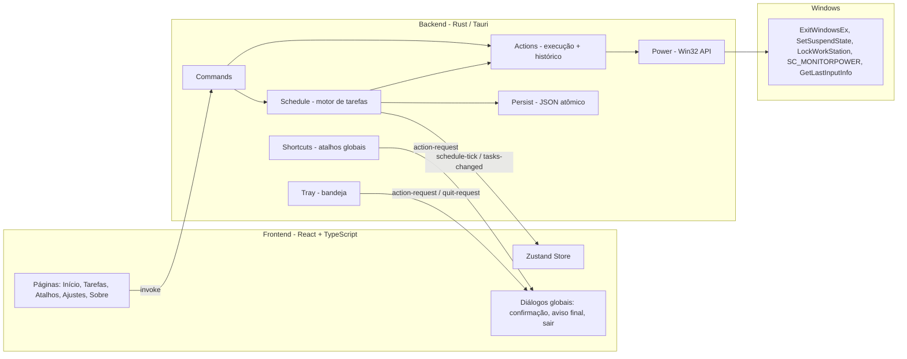

# ⚡ Wise Auto Shutdown

> **Gerencie o ciclo de energia do seu Windows 11 com estilo, tarefas agendadas e atalhos globais.**

O **Wise Auto Shutdown** é um aplicativo de desktop nativo, leve e bonito, feito para quem
quer desligar, reiniciar, suspender, hibernar, bloquear, encerrar sessão ou apagar a tela —
na hora, em tarefas agendadas (únicas, semanais ou por inatividade), via atalho de teclado ou
pela bandeja do sistema — sem caixas de diálogo feias ou comandos no terminal.

<div align="center">


</div>

---

## 📑 Sumário

- [O que é](#-o-que-é)
- [Funcionalidades](#-funcionalidades)
- [Como funciona](#-como-funciona)
- [Arquitetura e Engenharia](#️-arquitetura-e-engenharia)
- [Stack Tecnológica](#-stack-tecnológica)
- [Pré-requisitos](#-pré-requisitos)
- [Instalação](#-instalação)
- [Como usar](#-como-usar)
- [Dados do app e desinstalação](#️-dados-do-app-e-desinstalação)
- [Estrutura do projeto](#-estrutura-do-projeto)
- [Scripts e testes](#-scripts-e-testes)
- [Solução de problemas](#-solução-de-problemas)

---

## 💡 O que é

Um utilitário de energia para Windows 11 construído com [Tauri 2](https://v2.tauri.app/)
(Rust + WebView2), com interface Fluent e efeito **Mica** no Windows 11.

| Ação | Descrição resumida |
|------|--------------------|
| 🔌 **Desligar** | Fecha tudo e desliga o PC |
| 🔄 **Reiniciar** | Desliga e liga em seguida |
| 💤 **Suspender** | Baixo consumo, volta em 2–5s (RAM ligada) |
| 🌙 **Hibernar** | Salva RAM no disco, consumo zero |
| 🔒 **Bloquear** | Volta para a tela de login (programas continuam) |
| 🚪 **Encerrar sessão** | Fecha seus programas e sai da conta |
| 🖥️ **Desligar tela** | Apaga o monitor; o PC continua trabalhando |

Todas as ações são executadas **diretamente pela Win32 API** — sem `shutdown.exe`,
sem console escondido, sem problemas de *locale*.

---

## ✨ Funcionalidades

- ⚡ **7 ações de energia** com execução nativa via Win32.
- 🗓️ **Tarefas agendadas** — várias ao mesmo tempo, cada uma com sua ação:
  - **Daqui a** X horas/minutos (até 7 dias);
  - **Data e hora** específicas (até 1 ano);
  - **Repetir** toda semana (todos os dias, dias úteis ou dias escolhidos);
  - **Inatividade**: após N minutos sem teclado/mouse.
- 💾 **Tarefas persistidas** em disco: sobrevivem a fechar o app ou reiniciar o PC.
- ⏰ **Aviso final na tela** (configurável) com contagem regressiva e botões
  *Cancelar / Adiar 10 min / Executar agora* — aparece mesmo com o "Não incomodar".
- 🔔 **Lembrete** X minutos antes, por notificação do Windows.
- 😴 **PC suspenso ou app fechado no horário?** Se o atraso for pequeno, o app dá um
  período de graça com aviso; se for grande, a ocorrência é marcada como **perdida** (não
  desliga o PC de surpresa quando você volta).
- ☕ **Manter PC acordado** — manual ou automaticamente enquanto houver tarefa única pendente,
  para a suspensão automática do Windows não "engolir" um desligamento agendado.
- 📜 **Histórico** das últimas 100 ações (executadas, com erro ou perdidas).
- ⌨️ **Atalhos globais** seguros: validados contra conflitos com AltGr, atalhos do sistema
  e de outros programas; mostram se o Windows aceitou o registro; atalho opcional para
  **cancelar a próxima tarefa**.
- 🛡️ **Confirmação antes da ação** — vale para cliques, menu da bandeja **e atalhos**.
- 📦 **Bandeja do sistema** com ações rápidas, *Agendar desligamento* (15 min–3 h),
  *Adiar próxima tarefa*, *Cancelar próxima tarefa* e *Manter PC acordado*.
- 🚀 **Iniciar com o Windows** já minimizado na bandeja.
- 🪟 **Mica** no Windows 11 (fundo sólido no Windows 10) + tema Claro / Escuro / Sistema.
- 🧯 **Modo forçado** para desligar/reiniciar/encerrar sessão sem esperar programas.
- 🔌 **Hibernação** verificada via `GetPwrCapabilities` (reavaliada ao focar a janela).
- 🔁 **Instância única** — reabrir o app traz a janela existente ao foco.
- 🪵 **Logs** em arquivo, acessíveis por *Ajustes → Logs*.

---

## 🔧 Como funciona

Um **frontend web** (React) roda dentro da **WebView2** e conversa com um **backend Rust**
por comandos `invoke` e eventos.



**Motor de tarefas** (`schedule.rs`): um único loop assíncrono avalia todas as tarefas
ativas a cada segundo (alinhado ao segundo do alvo), emite `schedule-tick` com a próxima
tarefa, dispara lembretes, traz a janela à frente no aviso final, executa a ação e avança a
tarefa (única → removida; semanal → próxima ocorrência). O estado é salvo **antes** de
executar, para um desligamento não repetir a tarefa ao religar.

---

## 🏗️ Arquitetura e Engenharia

### Backend (`src-tauri/`) — Rust

| Módulo | Responsabilidade |
|--------|------------------|
| `main.rs` | Entry-point; `panic hook` que grava log em `%TEMP%`. |
| `lib.rs` | Builder do Tauri, plugins, setup, logs, fechamento da janela. |
| `commands.rs` | Todos os `#[tauri::command]` expostos ao frontend. |
| `actions.rs` | Execução centralizada, histórico, fluxo de confirmação. |
| `power.rs` | Win32: desligar, suspender, bloquear, apagar tela, ociosidade, manter acordado. |
| `schedule.rs` | Motor de tarefas (únicas, semanais, inatividade; adiar, pular, perdidas). |
| `trigger.rs` | Cálculo de horários (lógica pura, testada). |
| `hotkey_rules.rs` | Parsing/validação de atalhos (lógica pura, testada). |
| `shortcuts.rs` | Registro dos atalhos globais e status por atalho. |
| `settings.rs` | Configurações + migração de versões antigas. |
| `persist.rs` | JSON com escrita **atômica** (`.tmp` → rename) e backup se corromper. |
| `tray.rs` | Bandeja com itens dinâmicos. |
| `window.rs` | Mostrar/restaurar janela, tema, Mica, sempre no topo. |
| `state.rs` / `types.rs` | Estado compartilhado e tipos. |

**Decisões notáveis**

- **Win32 direta** — `ExitWindowsEx` com `EWX_FORCEIFHUNG` (normal) ou `EWX_FORCE` (forçado).
- **Atalhos sem padrão** — nenhum atalho vem ligado de fábrica; combinações `Ctrl+Alt+letra`
  são recusadas porque o Windows trata **AltGr** como Ctrl+Alt (digitar `/` no ABNT2 ou
  `ä` no US-Internacional dispararia a ação). Durante a captura, os atalhos ficam
  desregistrados. A versão 0.1 registrava `Ctrl+Alt+D/R/L/S/H/Q`; eles são removidos
  automaticamente na migração se nunca foram alterados.
- **Manter acordado** — `SetThreadExecutionState` numa thread dedicada (o estado é por thread).
- **Capabilities mínimas** — a WebView só pode minimizar, fechar e arrastar a janela; todo o
  resto passa por comandos do backend.

### Frontend (`src/`) — React + TypeScript

- **Zustand** com salvamento de configurações em série (sem perder alterações rápidas).
- Diálogos de confirmação, aviso final e saída renderizados no nível do App (funcionam em
  qualquer aba).
- Captura de atalhos por `KeyboardEvent.code` (tecla física), independente do layout.
- Acessibilidade: ARIA (tabs, switches, radiogroups, diálogos com foco preso), navegação por
  teclado, `Ctrl+1..5` para trocar de aba.

---

## 🧰 Stack Tecnológica

| Camada | Tecnologia |
|--------|-----------|
| Framework desktop | [Tauri 2](https://v2.tauri.app/) |
| Backend | Rust (edition 2021, `rust-version = 1.77.2`), Tokio, `windows` crate |
| WebView | WebView2 |
| UI | React 18 + TypeScript 5 + Vite 6 + Tailwind CSS 3 + lucide-react |
| Estado | Zustand 5 |
| Testes | `cargo test` + Vitest |
| Plugins Tauri | global-shortcut, notification, autostart, opener, single-instance |

---

## 📋 Pré-requisitos

- **Windows 11** (funciona no 10, sem Mica).
- [Node.js](https://nodejs.org/) **18+** e npm.
- [Rust](https://www.rust-lang.org/tools/install) stable 1.77.2+.
- [Microsoft C++ Build Tools](https://visualstudio.microsoft.com/visual-cpp-build-tools/).

---

## 📥 Instalação

### Usuário final

Baixe o instalador `.msi` ou `.exe` (NSIS) gerado pelo build (veja abaixo ou os artefatos
do workflow de CI) e execute — instala no modo *currentUser*, sem admin.

### Desenvolvedor

```bash
git clone <url-do-repositorio> wise-auto-shutdown
cd wise-auto-shutdown
npm install
npm run tauri:dev      # janela com hot-reload
npm run tauri:build    # instaladores em src-tauri/target/release/bundle/
```

---

## 🚀 Como usar

### Ações imediatas

Na aba **Início**, clique na ação. Com *Sempre pedir confirmação* ligado, um diálogo explica
o que vai acontecer e permite **forçar** (desligar/reiniciar/encerrar sessão).

### Tarefas

1. Vá em **Tarefas** e escolha o tipo: *Daqui a*, *Data e hora*, *Repetir* ou *Inatividade*.
2. Escolha a ação, o lembrete e, se quiser, *Forçar* (recomendado quando ninguém estará no PC).
3. Veja a prévia ("Vai executar hoje às 23:30") e clique em **Adicionar tarefa**.
4. A próxima tarefa aparece no **Início** com *+15 min* e *Cancelar/Pular*; a lista em
   **Tarefas** permite pausar recorrentes, pular a próxima ocorrência ou excluir.

### Atalhos globais

Em **Atalhos**, clique em **Capturar** e pressione a combinação. Boas opções:
`Ctrl+Alt+F9`, `Ctrl+Shift+F12`, combinações com `Win`. O status abaixo de cada atalho
mostra se o Windows aceitou. Há também um atalho opcional para **Cancelar próxima tarefa**.

### Bandeja do sistema

- **Clique esquerdo**: mostra/esconde a janela.
- **Clique direito**: ações, *Agendar desligamento*, *Adiar/Cancelar próxima tarefa*,
  *Manter PC acordado*, *Sair* (pergunta se houver tarefas ativas).

---

## 🗂️ Dados do app e desinstalação

Arquivos em `%APPDATA%\com.wise.autoshutdown\`:

| Arquivo | Conteúdo |
|---------|----------|
| `settings.json` | Configurações |
| `tasks.json` | Tarefas agendadas |
| `history.json` | Últimas 100 ações |

Logs em `%LOCALAPPDATA%\com.wise.autoshutdown\logs\` (*Ajustes → Logs → Abrir pasta*).

Para desinstalar use *Configurações → Apps*. Para remover os dados:

```powershell
Remove-Item -Recurse -Force "$env:APPDATA\com.wise.autoshutdown", "$env:LOCALAPPDATA\com.wise.autoshutdown"
Remove-Item -Force "$env:TEMP\wise-auto-shutdown-panic-*.log" -ErrorAction SilentlyContinue
```

---

## 📂 Estrutura do projeto

```
wise-auto-shutdown/
├── .github/workflows/ci.yml   # CI no Windows: testes, clippy, build e instaladores
├── src/                       # FRONTEND
│   ├── App.tsx                # Shell, abas, diálogos globais, tema/Mica
│   ├── components/            # ActionCard, ConfirmDialog, FinalWarning, QuitDialog, Modal, Toast...
│   ├── pages/                 # Home, Tasks, Hotkeys, Settings, About
│   ├── lib/                   # invoke, actions, format, hotkeys, tasks (+ __tests__)
│   ├── store/useStore.ts      # Zustand
│   └── types/                 # Tipos espelhando o Rust
└── src-tauri/                 # BACKEND (veja a tabela de módulos acima)
```

---

## 🛠️ Scripts e testes

| Comando | Descrição |
|---------|-----------|
| `npm run dev` | Vite em `localhost:1420`. |
| `npm run build` | `tsc` + `vite build`. |
| `npm test` | Testes do frontend (Vitest). |
| `npm run tauri:dev` | App em modo desenvolvimento. |
| `npm run tauri:build` | Build de produção + instaladores MSI/NSIS. |
| `cd src-tauri && cargo test` | Testes do backend (Windows). |

---

## 🩺 Solução de problemas

| Sintoma | Causa provável | Solução |
|---------|----------------|---------|
| **Hibernar** aparece "indisponível" | Hibernação desativada | `powercfg /hibernate on` como admin; o app reavalia ao focar a janela. |
| Atalho com status vermelho | Combinação já usada por outro programa | Capture outra combinação. |
| Atalho recusado ao capturar | Regra de segurança (AltGr, um só modificador, reservado) | Use F1–F12, setas ou `Win`. |
| Tarefa marcada como "perdida" | PC suspenso/desligado ou app fechado no horário | Esperado; ligue *Manter o PC acordado com tarefa pendente*. |
| Desligamento não aconteceu | Programa pedindo "salvar?" | Use *Forçar* em tarefas sem ninguém no PC. |
| Fechar não encerra o app | Bandeja ligada ou tarefas ativas | Use *Sair* no menu da bandeja. |
| Crash inesperado | — | Veja *Ajustes → Logs* e `%TEMP%/wise-auto-shutdown-panic-<usuário>.log`. |

---

<div align="center">

**Wise Auto Shutdown** · feito com Rust + Tauri + React

© 2025 Wise — Utilitário de energia para Windows 11

</div>
